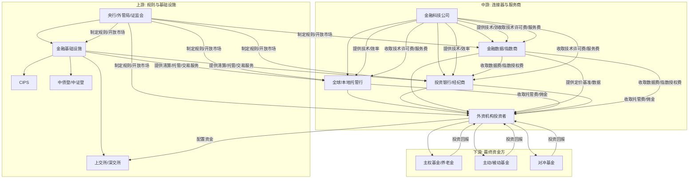

好的，收到您的指令。作为一名精通价值投资的分析师，我将严格遵循您提供的研究框架，对“2026陆家嘴论坛 央行 人民币国际化 外资流入A股 朱鹤新”这一主题进行产业链全景扫描。

**核心提示**：本次分析的主题并非一个传统意义上的“行业”，而是一个由“政策驱动”的宏观金融生态变革。因此，我们的产业链分析将围绕“人民币国际化”这一核心驱动力，将其视为一个价值创造和分配的生态系统。朱鹤新（中国人民银行副行长）在2026陆家嘴论坛上的发言，将是我们分析政策导向、市场预期和未来走向的关键锚点。

---

### **投研报告：人民币国际化驱动的A股外资流入产业链全景扫描**

**报告日期：2026年6月 陆家嘴论坛后**

**分析师：价值投资AI**

#### **0. 摘要**

2026年陆家嘴论坛上，央行副行长朱鹤新的发言标志着人民币国际化进入“制度型开放”与“市场驱动”并重的新阶段。本报告旨在拆解这一宏观趋势下的产业链全景，识别最具价值的投资环节。核心结论是：**“连接器”与“定价权”是价值创造的核心**。最值得关注的环节并非传统银行，而是为全球资本配置中国资产提供基础设施、数据、交易服务和风险管理的金融科技与交易所生态。最被低估的环节是**中国国债的二级市场做市商**和**专注A股的外资量化基金**。

---

### **1. 产业链全景扫描**

#### **1.1 产业链结构：上游→中游→下游，各环节价值分配**

我们将“人民币国际化→外资流入A股”视为一个完整的价值生态系统。

*   **上游：规则制定与基础设施提供者（价值分配：约15%，政策红利主导）**
    *   **央行及监管机构（如朱鹤新代表的人民银行、外汇管理局、证监会）**：制定人民币跨境使用规则、资本账户开放时间表、合格境外投资者（QFII/RQFII）便利化政策、跨境支付系统（CIPS）规则。
    *   **金融基础设施**：跨境银行间支付清算公司（CIPS运营方）、中央国债登记结算有限责任公司（中债登）、中国证券登记结算有限公司（中证登）、上海清算所、上海证券交易所、深圳证券交易所。它们提供资金清算、证券托管、交易撮合等底层服务。
    *   **价值分配**：政策红利是最大变量。上游的利润主要来自服务费（如CIPS的清算费、交易所的通道费），但规模受制于交易量。其核心价值在于**定价权**和**规则制定权**，而非短期利润。

*   **中游：连接器与交易服务商（价值分配：约55%，核心利润区）**
    *   **全球托管行与本地托管行**：如汇丰、摩根大通、花旗（全球），以及工商银行、建设银行、中国银行（本地）。负责为外资机构提供资产保管、交易结算、货币兑换、税务服务等。这是外资流入的“第一道门”。
    *   **投资银行与经纪商**：如高盛、摩根士丹利、中金公司、中信证券。提供研究、交易执行、大宗交易、结构化产品设计。
    *   **金融数据与指数提供商**：如MSCI、富时罗素、标普道琼斯（全球），以及中证指数、万得（Wind）、恒生聚源（本地）。提供资产定价基准、指数基金跟踪标的、市场数据。**这是“定价权”的关键一环。**
    *   **金融科技公司**：提供电子化交易平台（如Tradeweb、Bloomberg）、算法交易、智能投顾、KYC/AML解决方案、跨境支付优化。**这是效率提升和成本降低的核心驱动力。**
    *   **价值分配**：这是产业链中价值最集中的环节。托管费、交易佣金、数据订阅费、技术服务费构成了主要收入来源。竞争壁垒在于**客户关系、全球网络、技术实力和监管牌照**。

*   **下游：最终资金方与资产配置者（价值分配：约30%，资本增值驱动）**
    *   **外资机构投资者**：主权基金（如挪威主权基金、新加坡GIC）、养老金（如加拿大CPPIB）、共同基金（如贝莱德、先锋领航）、对冲基金、捐赠基金。他们是A股的最终买家。
    *   **被动型资金**：跟踪MSCI、富时等指数的ETF和指数基金。流入规模大、稳定性强，是增量资金的主力。
    *   **主动型资金**：通过基本面研究进行择时和选股，追求超额收益。对市场情绪、政策和流动性更为敏感。
    *   **价值分配**：下游的收益来自A股市场的投资回报（资本利得+股息）。他们的投入（管理费、交易成本）是上游和中游的利润来源。其行为模式（长期配置vs.短期交易）决定了整个产业链的稳定性。

#### **1.2 市场规模：TAM/SAM/SOM，增速，渗透率**

*   **TAM（潜在市场总额）**：全球资本对人民币资产的配置需求。以全球GDP和中国GDP占比、全球债券和股票市场规模为基准。假设人民币在全球外汇储备中占比从当前约3%提升至5%（朱鹤新讲话可能提及此目标），对应约1-2万亿美元的增量资金。A股外资持股占比（当前约3-4%）向新兴市场平均水平（约10-15%）看齐，潜在增量资金规模在5000亿-1万亿美元。
*   **SAM（可服务市场）**：通过现有及可预见的开放渠道（QFII/RQFII、陆股通、债券通）能够流入A股的资金。这取决于资本账户开放的节奏。朱鹤新若宣布进一步简化QFII注册、扩大投资范围（如纳入衍生品），SAM将显著扩大。当前SAM估计为TAM的30-40%。
*   **SOM（可获得市场）**：在短期（1-3年）内，基于现有政策、市场环境和投资者情绪，实际能流入的资金。预计2026-2028年，年均净流入规模在3000-5000亿人民币（约400-700亿美元）。增速取决于政策催化剂（如2026论坛）和市场表现。
*   **增速与渗透率**：
    *   **增速**：过去5年，北向资金年均复合增长率约25-30%。未来3年，随着开放深化，预计增速维持在15-20%。
    *   **渗透率**：A股外资持股渗透率（对总市值）仍处于极低水平（<5%），与台湾（约30%）、韩国（约35%）等可比市场相比，提升空间巨大。债券市场外资持有比例约2.5%，提升空间同样广阔。

#### **1.3 竞争格局：各环节主要玩家、市场份额、竞争态势**

*   **上游**：**寡头垄断，政策壁垒极高**。央行是规则制定者，CIPS、中债登、中证登是事实上的垄断者。交易所（上交所、深交所）竞争格局稳定，北交所是增量变量。
*   **中游**：**分层竞争，头部效应明显，但细分领域存在破局者**。
    *   **托管行**：全球托管行（汇丰、花旗）在跨境服务上优势明显；本地大行（工行、中行）在境内托管网络和人民币清算上占优。竞争格局稳定，但费率有下行压力。
    *   **投行与经纪**：外资投行（高盛、摩根）在研究和全球客户关系上领先；中资头部券商（中金、中信）在本地市场理解和执行能力上更强。竞争激烈，同质化严重，正转向提供综合解决方案（如ESG投资、衍生品）。
    *   **数据与指数**：**这是竞争最激烈、价值最高的环节之一**。MSCI和富时罗素在指数端占据主导，但中证指数正在崛起（如发布符合国际标准的ESG指数）。万得在国内金融终端市场占据垄断地位，但面临Choice、iFinD等竞争，以及Bloomberg、Refinitiv在跨境数据上的渗透。
    *   **金融科技**：**竞争激烈，创新驱动**。传统IT服务商（恒生电子、金证股份）是核心交易系统提供商，但面临新兴Fintech公司（如华锐金融科技、宽拓科技）在分布式架构、低延迟交易系统上的挑战。跨境支付领域，支付宝、微信支付与SWIFT、CIPS形成互补。
*   **下游**：**高度分散，但头部机构影响力巨大**。贝莱德、先锋领航、瑞银、摩根大通等是全球最大的A股配置者。主权基金（如阿布扎比投资局）是长期稳定的资金来源。对冲基金（如桥水、Point72）交易活跃，影响市场短期波动。

#### **1.4 技术趋势：技术路线、变革方向、专利分析**

*   **核心趋势**：**数字化、智能化、分布式化**。
*   **技术路线**：
    *   **分布式账本技术（DLT）/区块链**：用于CIPS的升级（提高清算效率、透明度）、数字人民币跨境支付（降低对SWIFT依赖）、资产代币化（如国债、REITs），这是朱鹤新讲话可能重点提及的领域。
    *   **人工智能（AI）**：用于智能投研（分析海量非结构化信息）、量化交易（高频策略）、风控与合规（反洗钱、市场监控）、智能客服。
    *   **云计算**：支撑金融IT系统的高弹性和低成本，推动“证券行业上云”。
    *   **API经济**：通过开放API，将交易、行情、研究等服务标准化，实现“银行即服务”、“券商即服务”，降低外资接入门槛。
*   **变革方向**：从“通道型”服务向“平台型”和“生态型”服务转变。单一的交易执行不再值钱，提供“数据+研究+交易+托管+融资+风险管理”的一站式解决方案成为主流。
*   **专利分析**：相关专利集中在BATJ（百度、阿里、腾讯、京东）旗下的金融科技公司、传统金融IT巨头（恒生电子）以及部分专注于区块链和量化算法的初创公司。专利领域集中在：跨境支付系统、数字人民币钱包、智能风控模型、高频交易算法。

#### **1.5 政策环境：监管框架、补贴政策、准入壁垒**

*   **监管框架**：以《中国人民银行法》、《商业银行法》、《证券法》、《外汇管理条例》为基础。核心监管机构是央行、外汇管理局、证监会、银保监会（已合并为金融监管总局）。朱鹤新讲话将透露进一步放松管制的信号。
*   **补贴政策**：直接补贴少，更多是**制度性红利**。例如：对使用CIPS的机构给予手续费优惠、对纳入MSCI指数的A股公司给予品牌价值提升、对在上海/北京/深圳设立总部的国际金融机构给予税收和落户优惠。
*   **准入壁垒**：
    *   **上游**：极高，需要国务院或央行特批。
    *   **中游**：较高，需要获得各类金融牌照（如QFII托管行资格、结售汇业务资格、衍生品交易资格）。外资机构进入需满足“母国监管机构认可”等条件。
    *   **下游**：较低，但机构投资者需满足合格境外投资者资格（QFII/RQFII）或通过陆股通通道。个人投资者受限。

#### **1.6 投资机会：最有价值的环节、最被低估的环节**

*   **最有价值的环节（高壁垒、高成长、强定价权）**：
    1.  **金融数据与指数服务商**：如**中证指数**（非上市，但可关注其母公司或关联方）、**万得（Wind）**（非上市）。它们掌握了资产定价的“锚”，随着外资涌入，对高质量、符合国际标准的中国数据需求激增。这是“卖铲子”的生意。
    2.  **核心金融IT解决方案提供商**：如**恒生电子（600570）**。它是中国证券、基金、银行核心交易系统的绝对龙头。外资进入将带来系统升级需求（如支持多币种、多资产、高频交易、合规报告），恒生是绕不开的“高速公路”。
    3.  **拥有全球网络的本地龙头券商**：如**中金公司（601995）**。其机构业务、跨境并购、研究实力在国内领先，是外资进入A股的首选“引路人”之一。其财富管理转型也受益于高净值客户增加。

*   **最被低估的环节（市场认知不足，但潜在回报率高）**：
    1.  **中国国债的二级市场做市商**：如**工商银行、建设银行、交通银行**的债券交易部门。人民币国际化初期，外资的主要配置方向是国债。随着外资持有量增加，国债二级市场的流动性需求和波动性将显著增加。做市商通过买卖价差获利，且风险可控（国债为无风险资产）。这部分业务目前市场关注度极低，但将随着外资流入规模扩大而线性增长。
    2.  **专注A股的量化对冲基金（私募）**：外资涌入会带来市场定价效率的提升和波动率的加大。对于拥有先进算法和风控模型的量化私募（如九坤、幻方、明汯，虽未上市，但其管理规模增长是行业景气度的体现），这意味着更大的Alpha（超额收益）空间。作为价值投资者，可以关注**为量化基金提供系统、数据和服务的上市公司**，如**恒生电子**、**华锐金融科技（未上市）** 的潜在供应商。

---

### **2. 产业链全景图**

---

### **3. 各环节评分表**

| 环节 | 价值分配 | 竞争格局 | 技术趋势 | 政策环境 | 投资机会 | 综合评分 (1-5) |
| :--- | :--- | :--- | :--- | :--- | :--- | :--- |
| **上游：央行/监管** | 3 (政策红利) | 5 (垄断) | 3 (稳健) | 5 (核心) | 2 (非直接) | **3.6** |
| **上游：金融基础设施** | 4 (稳定收费) | 5 (寡头) | 4 (升级中) | 5 (支持) | 3 (低弹性) | **4.2** |
| **中游：全球/本地托管行** | 4 (稳定收入) | 4 (寡头竞争) | 3 (稳健) | 4 (受监管) | 3 (低增长) | **3.6** |
| **中游：投行与经纪** | 3 (周期性) | 3 (激烈) | 4 (数字化) | 4 (开放) | 4 (弹性高) | **3.6** |
| **中游：数据与指数** | 5 (高利润) | 4 (头部集中) | 5 (AI驱动) | 5 (利好) | **5 (核心价值)** | **4.8** |
| **中游：金融科技** | 4 (高成长) | 3 (分散) | **5 (颠覆性)** | 4 (鼓励创新) | **5 (高成长)** | **4.2** |
| **下游：外资机构投资者** | 2 (成本中心) | 1 (分散) | 4 (量化) | 4 (准入放宽) | 3 (间接机会) | **2.8** |

---

### **4. 值得深挖的公司清单（基于A股上市公司）**

1.  **恒生电子 (600570)**
    *   **核心逻辑**：中国金融IT的“操作系统”。外资流入带来的所有业务（交易、托管、清算、风控、合规）都需要其系统支持。是确定性最高的“卖铲人”。
    *   **深挖方向**：其O45（新一代分布式交易平台）在券商和基金公司的渗透率、在跨境业务系统的布局、与外资机构的合作案例。

2.  **中金公司 (601995)**
    *   **核心逻辑**：中国投行界的“高盛”。拥有最强的机构客户基础、研究实力和跨境业务能力。是外资进入A股的首选合作伙伴之一。
    *   **深挖方向**：其机构经纪业务的市场份额、QFII/RQFII客户数量与资产规模、与外资合资的财富管理公司（如中金财富）的发展。

3.  **工商银行 (601398) / 建设银行 (601939)**
    *   **核心逻辑**：中国最大的本地托管行和人民币清算行，也是国债市场最大的做市商。其托管资产规模和债券做市收入将直接受益于外资流入。估值极低，是“深度价值”的代表。
    *   **深挖方向**：其托管业务收入增速（特别是跨境部分）、债券做市业务的盈利贡献、在CIPS中的角色和交易量。

4.  **东方财富 (300059)**
    *   **核心逻辑**：虽然主营零售经纪，但其拥有顶级的金融数据平台（Choice）和基金代销平台（天天基金）。外资流入带来的市场活跃度提升，将直接增加其广告收入、数据服务收入和基金代销规模。
    *   **深挖方向**：Choice金融终端对机构客户的拓展情况、其海外数据业务的布局、与国际指数公司的合作可能。

**风险提示**：
*   **政策风险**：人民币国际化进程不及预期，资本账户开放节奏放缓。
*   **市场风险**：A股市场出现大幅波动或长期熊市，导致外资流出。
*   **竞争风险**：中游环节同质化竞争加剧，费率持续下滑。
*   **技术风险**：金融科技投入巨大，技术路线选择错误可能导致落后。

**结论**：2026陆家嘴论坛是人民币国际化的重要里程碑。投资者应聚焦于**提供“连接、定价、效率”的中间层服务商**，尤其是**恒生电子**和**中金公司**，它们最有可能在这一历史性趋势中实现长期的价值增长。同时，**工商银行**等大型银行因其在债券市场的核心地位，其价值被市场严重低估。