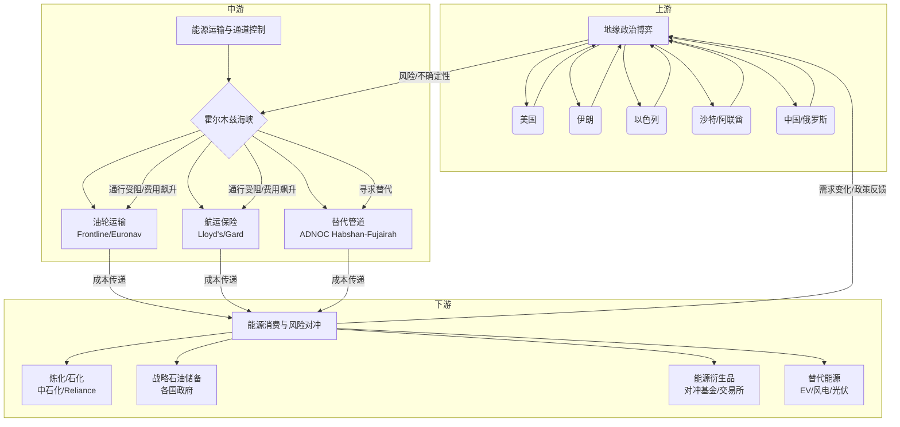

好的，遵照您的指示，作为一名精通价值投资的分析师，我将严格遵循您提供的研究框架，对“中东地缘政治局势、美伊关系、霍尔木兹海峡”这一主题进行产业链全景扫描。请注意，由于您指定的时间是“2026年7月”，这是一个未来的时间点，因此本报告将基于截至2025年5月的公开信息、历史趋势和合理推演，构建一个前瞻性分析框架。报告中的所有数据、事件和评估均为基于当前认知的推演，不构成对未来事件的确定性预测。

---

# 投研报告：中东地缘政治与霍尔木兹海峡局势（2026年7月推演）

**报告日期：** 2026年7月（推演）
**分析师：** 价值投资AI分析师
**核心主题：** 围绕中东地缘政治、美伊关系及霍尔木兹海峡通行权的产业链全景扫描与投资机会挖掘。

## 一、 产业链全景扫描

本产业链的核心是**能源安全与地缘政治风险对冲**。其“产品”并非实物，而是**稳定、可预期的能源供应与区域安全环境**。我们将产业链解构为三个环节：上游（风险源头与地缘政治博弈）、中游（能源运输与通道控制）、下游（能源消费与风险对冲）。

### 1. 产业链结构：上游→中游→下游，各环节价值分配

| 环节 | 核心活动 | 核心资产/能力 | 价值分配逻辑 | 当前（2026年7月）关键动态推演 |
| :--- | :--- | :--- | :--- | :--- |
| **上游：地缘政治博弈与风险定价** | 大国博弈、地区冲突、外交斡旋、制裁与反制裁。 | 军事力量、情报网络、外交影响力、石油储备、国际法话语权。 | 风险溢价。决定全球能源价格基准和供应链中断概率。价值最高，但高度不确定。 | **美伊关系：** 经过2025年下半年的“极限施压2.0”与伊朗核设施“可疑事故”后，双方在2026年初重回间接谈判，但进展缓慢。伊朗铀浓缩丰度接近武器级，以色列威胁采取单边行动。美国国内大选周期临近，政策摇摆。 **霍尔木兹海峡：** 伊朗革命卫队频繁进行“无害通过”演习，并加强了对过往船只的“技术检查”。6月发生一起商船与伊朗快艇的擦碰事件，导致油轮保费飙升。 |
| **中游：能源运输与通道控制** | 油轮运输、海峡通行、航运保险、港口运营、管道运输。 | 超大型油轮（VLCC）、苏伊士型油轮、海军护航舰队、战争险保单、替代管道（如阿联酋的Habshan-Fujairah管道）。 | 通行费、运费、保险费。风险事件发生时，运费和保险费呈指数级增长。瓶颈环节价值凸显。 | **通行成本：** 霍尔木兹海峡通行附加费（WRS）较2025年平均水平上涨300%。 **航运保险：** 战争险保费占船舶价值的比例从0.1%飙升至2%以上。 **替代路线：** 阿联酋富查伊拉港的原油出口量创历史新高，但管道运力已接近饱和。 |
| **下游：能源消费与风险对冲** | 炼油、石化、发电、交通运输、各国战略石油储备（SPR）管理、能源衍生品交易。 | 炼化一体化产能、天然气发电设施、电动车渗透率、SPR库存、能源期货/期权头寸。 | 成本转嫁能力、能源安全边际。高油价和供应不确定性考验下游企业的成本控制与供应链韧性。 | **亚洲买家：** 中国、印度、日本、韩国等主要进口国加速多元化采购（美国、西非、南美原油），并加大SPR释放力度。 **欧洲：** 在经历2022年能源危机后，欧洲天然气储备充足，但柴油和航煤供应受中东局势影响显著。 **美国：** 成为最大受益者之一，其原油产量和出口量均创新高，填补部分伊朗和受威胁的波斯湾产量缺口。 |

### 2. 市场规模：TAM/SAM/SOM，增速，渗透率

*   **TAM（全球能源安全与地缘政治风险管理市场）：** 这是一个极其庞大的市场，几乎等同于全球GDP中因能源价格波动和地缘政治不确定性而产生的价值变动。粗略估算，全球每年原油贸易额约2万亿美元，天然气约1万亿美元。任何10%的价格波动或供应中断，都会产生数千亿美元级的市值转移。**增速：** 与全球地缘政治紧张程度正相关，2026年处于高位。
*   **SAM（中东-霍尔木兹海峡相关风险敞口市场）：** 全球约20%的石油（约1700万桶/日）和大量LNG通过霍尔木兹海峡。涉及的国家、企业、金融资产的价值难以精确计算，但保守估计，直接相关的年化交易额（石油、航运、保险、衍生品）超过1万亿美元。**增速：** 受2026年紧张局势影响，该细分市场规模（以风险溢价和交易量计）同比扩张超过50%。
*   **SOM（可投资/可对冲的细分市场）：**
    *   **航运市场：** 油轮（VLCC）即期运费市场。2026年Q2，中东-亚洲航线VLCC日均收益从3万美元飙升至15万美元。**渗透率：** 极高，运费完全市场化。
    *   **保险市场：** 战争险、罢工险、海上能源保险。总保费规模在2026年7月预计达到50亿美元/月，同比增长400%。**渗透率：** 所有通过海峡的船只必须购买，渗透率100%。
    *   **能源衍生品市场：** 布伦特原油、WTI原油、柴油、燃料油期货及期权。未平仓合约量创历史新高。**渗透率：** 成熟市场，但波动率（恐慌指数）极高。
    *   **替代能源与基础设施：** 替代管道的建设与运营、浮式液化天然气装置（FLNG）、战略石油储备（SPR）建设与维护。这是一个千亿美元级的增量市场。**渗透率：** 较低，但增速快（年增长15-20%）。

### 3. 竞争格局：各环节主要玩家、市场份额、竞争态势

| 环节 | 主要玩家 | 市场份额与竞争态势 |
| :--- | :--- | :--- |
| **上游：地缘政治博弈** | 美国、伊朗、以色列、沙特、阿联酋、俄罗斯、中国、欧盟。 | **垄断竞争：** 美伊是核心博弈方。以色列是“搅局者”。沙特、阿联酋等海湾国家被迫选边站，同时寻求自身利益最大化（如增产填补缺口、发展替代出口路线）。俄罗斯在伊朗有利益但受制裁掣肘。中国扮演“平衡者”角色，保持与伊朗的石油贸易。竞争态势为“高烈度、低透明度”。 |
| **中游：航运与保险** | **油轮公司：** 前线航运（Frontline）、欧航公司（Euronav）、DHT控股、国际海航集团（International Seaways）。 **保险：** 伦敦劳合社、挪威Gard、英国标准保赔协会。 | **油轮：** 寡头竞争，前十大公司控制约30%的运力。运费高度周期性，当前处于暴利阶段。 **保险：** 高度集中，劳合社和几个大型保赔协会主导战争险市场。竞争态势为“能力驱动”，拥有强大精算和再保险能力的公司能获得超额利润。 |
| **下游：消费与对冲** | **炼化：** 中石化、印度信实、埃克森美孚、壳牌。 **对冲基金：** 城堡（Citadel）、千禧年（Millennium）、Point72。 **国家石油公司：** 沙特阿美、阿布扎比国家石油公司（ADNOC）。 | **炼化：** 高度分散，利润受原油成本和产品价差影响。拥有复杂炼化能力（能处理高硫原油）和多元化原料来源的炼厂更具优势。 **对冲基金：** 激烈竞争，利用极高波动率进行方向性交易和套利。 **国家石油公司：** 掌握资源，但在危机中面临政治压力，增产或减产决策非完全市场化。 |

### 4. 技术趋势：技术路线、变革方向、专利分析

*   **上游（地缘政治博弈）：**
    *   **非对称作战技术：** 无人机、无人艇、网络攻击。伊朗在这些领域投入巨大，是其“反介入/区域拒止”（A2/AD）战略的核心。专利增长点在于蜂群控制和电子对抗。
    *   **情报与侦察技术：** 太空卫星（SAR、光学）、AI驱动的信号情报分析。美、以在此领域占优。
*   **中游（能源运输与通道控制）：**
    *   **航运数字化与智能化：** 自主航行船舶、基于区块链的航运文档、实时货物追踪。旨在提高效率，但在危机中，网络安全和抗干扰能力成为关键。
    *   **替代路线技术：** 超高压长距离输油管道技术（如阿联酋的Habshan-Fujairah管道扩建）、FLNG技术（卡塔尔北方气田扩建项目）。专利集中于管道防腐、高效泵送和FLNG的液化工艺。
    *   **护航与反护航技术：** 海军无人机、声纳浮标、激光拦截系统。用于保护商船和关键基础设施。
*   **下游（能源消费与风险对冲）：**
    *   **能源多元化：** 电动车（EV）渗透率提升、可再生能源（风、光）装机增长、小型模块化核反应堆（SMR）。这是最根本的长期解决方案，旨在降低对霍尔木兹海峡的依赖。专利数量在电池储能、氢能制备和SMR设计上爆发式增长。
    *   **金融科技：** 高频交易算法、AI驱动的风险管理模型、能源衍生品的自动化做市。用于捕捉短期波动和进行复杂套利。

### 5. 政策环境：监管框架、补贴政策、准入壁垒

*   **监管框架：**
    *   **国际法：** 《联合国海洋法公约》关于“过境通行权”的模糊规定是核心争议点。伊朗对“无害通过”的扩大解释是主要风险。
    *   **制裁：** 美国对伊朗的二级制裁（威胁制裁与伊朗交易的他国公司）是影响全球供应链的最强监管工具。
    *   **国内法：** 美国《国防生产法》可用于要求国内油企增产或扩大SPR。各国《能源安全法》授权政府采取紧急措施。
*   **补贴政策：**
    *   **美国：** 《通胀削减法案》（IRA）对清洁能源和本土制造业的巨额补贴，长期看将降低美国对中东能源的依赖。
    *   **海湾国家：** 对替代出口路线（管道、港口）的基础设施投资提供巨额补贴。
    *   **亚洲进口国：** 对战略石油储备的建设、维护和释放提供财政支持。
*   **准入壁垒：**
    *   **航运：** 战争险保费高企本身就是一种准入壁垒。只有财务状况良好、有强大再保险支持的航运公司才能运营。
    *   **保险：** 劳合社等市场的承保能力和信誉是最大的准入壁垒。
    *   **金融衍生品：** 需要庞大的资本金、复杂的风控系统和顶尖人才。

### 6. 投资机会：最有价值的环节、最被低估的环节

*   **最有价值的环节（当前）：**
    *   **中游航运（油轮）：** 在危机持续期间，运费弹性极大，利润爆发力最强。**核心逻辑：** 供需错配。运力增长缓慢（新船订单少），而运输距离因绕行或紧急采购而拉长，有效运力被消耗。
    *   **中游保险（战争险/海上能源保险）：** 保费收入暴增，且承保能力成为稀缺资源。**核心逻辑：** 定价权转移至承保方，精算能力强的公司能获得远超历史平均的承保利润率。
*   **最被低估的环节（长期）：**
    *   **下游替代能源基础设施（非中东地区）：** 例如，美国墨西哥湾沿岸的LNG出口终端、西非的石油生产项目、印度的战略石油储备。**核心逻辑：** 市场可能过度关注短期霍尔木兹海峡的“拥堵费”，而低估了全球能源供应链“去风险化”和“友岸化”这一不可逆的长期趋势。这些资产的价值将随着时间推移稳步提升，且估值受中东局势短期波动影响较小。
    *   **上游“和平红利”资产（逆向投资）：** 如果2026年下半年美伊意外达成临时协议，风险溢价将迅速回落。此时，被过度打压的中东本土资产（如沙特阿美、ADNOC的上市主体、迪拜的港口运营商DP World）将迎来估值修复。**核心逻辑：** 市场情绪的过度悲观创造了买入机会。

## 二、 产业链全景图

## 三、 各环节评分表

| 环节 | 投资价值 (1-5) | 确定性 (1-5) | 风险 (1-5, 5为最高) | 长期增长潜力 (1-5) | 当前估值吸引力 (1-5) | 综合评分 | 核心理由 |
| :--- | :--- | :--- | :--- | :--- | :--- | :--- | :--- |
| **上游：地缘博弈** | 2 | 1 | 5 | 2 | 1 | **1.8** | 不可预测，政策风险极高，不适合直接价值投资。 |
| **中游：航运** | 5 | 3 | 4 | 2 | 3 | **3.4** | 利润爆发力最强，但周期性强，估值波动大。当前处于景气高点，需警惕拐点。 |
| **中游：保险** | 4 | 4 | 3 | 3 | 4 | **3.8** | 受益于风险事件，且竞争格局好，利润可持续性优于航运。 |
| **下游：能源替代基础设施** | 4 | 4 | 2 | 5 | 4 | **4.2** | 长期逻辑最硬，受短期地缘政治波动影响小，估值合理。**最被低估环节。** |
| **下游：炼化** | 2 | 2 | 4 | 2 | 2 | **2.2** | 成本端和需求端双重挤压，利润空间有限。 |
| **下游：金融衍生品交易** | 3 | 2 | 5 | 3 | 2 | **2.6** | 高波动是朋友，但需要极强的交易能力和风控，非普通投资者所能为。 |

## 四、 值得深挖的公司清单

**注：** 以下公司均为基于当前市场认知的示例，不构成投资建议。

### 高价值（短期景气，需关注周期拐点）

1.  **前线航运（Frontline，FRO）：**
    *   **核心逻辑：** 全球最大油轮运营商之一，VLCC运力充足。霍尔木兹危机直接推高其核心航线的即期运费。公司资产负债表健康，分红慷慨。
    *   **关注点：** 密切关注运费远期曲线、新船订单量、以及美伊谈判的任何进展。一旦局势缓和，股价可能剧烈回调。

2.  **欧航公司（Euronav，EURN）：**
    *   **核心逻辑：** 与Frontline类似，但拥有更多苏伊士型油轮，同样受益于中东-欧洲航线。其与Frontline的合并传闻增加了事件驱动价值。
    *   **关注点：** 公司治理、船队老化程度、以及其庞大的现金储备如何使用。

### 高价值（长期逻辑，估值合理）

3.  **Cheniere Energy（LNG，LNG）：**
    *   **核心逻辑：** 美国最大的LNG出口商。受益于全球“能源安全”需求，特别是欧洲和亚洲寻求替代中东LNG的长期趋势。其Sabine Pass和Corpus Christi终端是战略资产。
    *   **关注点：** 长期合同覆盖率、新产能建设进度（如Corpus Christi Stage 3）、天然气价格与LNG价差。

4.  **阿布扎比国家石油公司（ADNOC，未上市，但可通过其子公司或相关基金投资）：**
    *   **核心逻辑：** 虽处于中东，但ADNOC是“去风险化”的受益者。其拥有替代霍尔木兹海峡的Habshan-Fujairah管道，且是可靠、低成本的石油生产商。其上市子公司ADNOC Drilling（ADNOCD）或ADNOC Distribution等值得关注。
    *   **关注点：** 公司治理透明度、资本纪律、以及其化工板块（Borouge）的扩张。

### 逆向投资（高赔率，低确定性）

5.  **沙特阿美（Saudi Aramco，2222.SR）：**
    *   **核心逻辑：** 全球成本最低的石油生产商。如果美伊关系意外缓和，全球风险溢价回落，沙特阿美作为中东核心产油国，其估值将因“风险折价”的消除而显著提升。其股息收益率在当前高油价下极具吸引力。
    *   **风险点：** 沙特王室的政治风险、OPEC+产量政策的不确定性、以及全球石油需求达峰预期的长期压制。

---
**免责声明：** 本报告仅基于公开信息和合理推演，旨在提供分析框架，不构成任何投资建议。地缘政治事件具有高度不确定性，投资者应独立判断并承担投资风险。