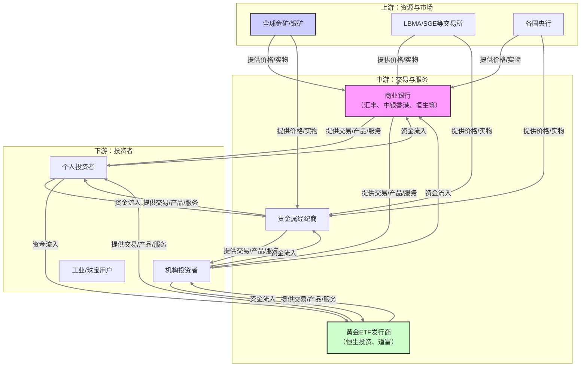

好的，收到您的指令。作为一位精通价值投资的分析师，我将严格遵循您提供的框架，对“港股市场走势、恒生指数、银行收紧贵金属交易”这一特定主题，结合您设定的“2026年7月”这一未来时间点，进行一次前瞻性的产业链全景扫描分析。

**重要提示：** 本报告基于对2024年现状的合理外推和假设，旨在提供一个结构化的分析范式，而非对2026年7月具体事件的预测。实际市场情况将受众多不可预见因素影响。

---

### **投研报告：港股市场、恒生指数与银行收紧贵金属交易（前瞻至2026年7月）**

**报告日期：** 2024年（基于当前趋势展望至2026年7月）
**核心主题：** 在港股市场结构性变化与银行贵金属交易收紧的背景下，恒生指数成分股及金融产业链的投资机会与风险。

---

### **1. 产业链全景扫描**

我们定义此产业链的“产品”为 **“通过银行渠道进行的贵金属（主要是黄金、白银）投资及交易服务”**，其核心是连接投资者（下游）与贵金属市场（上游）的金融中介服务。

#### **1.1 产业链结构：上游→中游→下游，各环节价值分配**

*   **上游：贵金属资源与市场**
    *   **环节构成：** 金矿开采商（如山东黄金、紫金矿业H股）、伦敦金银市场协会（LBMA）、上海黄金交易所（SGE）、全球主要央行（黄金储备管理）。
    *   **价值分配：** 掌握资源定价权，价值受全球供需、地缘政治、美元实际利率影响。利润波动大，与金价强相关。
    *   **与港股关联：** 港股中的资源股（如紫金矿业、招金矿业）直接受益于金价上涨，但受开采成本、产量、环保政策影响。

*   **中游：银行贵金属交易服务商**
    *   **环节构成：** 商业银行（如汇丰、中银香港、恒生银行、工商银行亚洲）、贵金属经纪商。
    *   **核心功能：** 提供账户贵金属（纸黄金）、实物金条/金币销售回购、黄金ETF联接产品、黄金积存（积存金）、代理上海金交所业务、以及部分杠杆类交易（如黄金T+D，但已被大幅收紧）。
    *   **价值分配：** 赚取买卖价差、交易手续费、仓储费、管理费。此环节是政策监管的焦点。**“银行收紧贵金属交易”直接冲击此环节的营收与风险敞口。**
    *   **当前趋势（至2026年7月）：** 银行持续收紧个人贵金属交易业务。具体措施可能包括：
        1.  **关闭新开仓：** 暂停账户贵金属（纸黄金/纸白银）的新开仓业务，仅允许平仓。
        2.  **提高门槛：** 大幅提高风险测评等级，要求更长的投资经验。
        3.  **调整产品结构：** 从带杠杆的T+D业务转向低杠杆或无杠杆的积存金、实物金业务。
        4.  **压缩交易时间：** 减少夜盘交易时间，降低波动风险。

*   **下游：投资者**
    *   **环节构成：** 个人投资者（散户）、机构投资者（对冲基金、保险公司、养老基金）、企业（珠宝商、工业用金企业）。
    *   **需求驱动：** 避险需求（对抗通胀、地缘风险）、资产配置、投机交易、消费需求（珠宝）。
    *   **与港股关联：** 投资者行为直接影响恒生指数的资金流向。当银行渠道受限，部分资金可能流入：
        1.  **港股黄金ETF：** 如SPDR金ETF（02840）、价值黄金ETF（03081）。
        2.  **港股黄金矿企股：** 成为间接投资黄金的替代渠道。
        3.  **其他避险资产：** 高股息、低波动的港股公用事业股或电信股。

#### **1.2 市场规模：TAM/SAM/SOM，增速，渗透率**

*   **TAM（总可寻址市场）：** 全球个人与机构通过金融渠道进行的贵金属投资总规模。预计2026年，受全球不确定性（通胀、去美元化、地缘冲突）影响，TAM将维持中高个位数增长。
*   **SAM（可服务市场）：** 中国内地及香港居民通过银行体系进行的贵金属投资规模。由于银行持续收紧，**SAM增速将显著放缓，甚至可能出现萎缩**。银行将主要服务于高净值客户的定制化实物金业务。
*   **SOM（可获得市场）：** 恒生指数成分股中，与贵金属相关的银行及矿企所占据的市场份额。银行部分（如汇丰、中银香港）的SOM因业务收缩而下降；矿企部分（如紫金矿业）的SOM因金价上涨而提升。
*   **渗透率：** 中国居民资产中贵金属配置比例仍较低（约1-2%），远低于发达国家（5-10%）。但银行渠道的收紧，**限制了渗透率的快速提升**。

#### **1.3 竞争格局：各环节主要玩家、市场份额、竞争态势**

*   **上游（矿企）：**
    *   **主要玩家：** 紫金矿业（02899）、招金矿业（01818）、山东黄金（01787）。
    *   **竞争态势：** 成本控制、矿山储量和产量扩张是核心竞争力。紫金矿业凭借全球化布局和低成本，成为龙头。行业集中度在提升。
*   **中游（银行）：**
    *   **主要玩家：** 汇丰控股（00005）、中银香港（02388）、恒生银行（00011）、工商银行（01398）、建设银行（00939）。
    *   **竞争态势：** 在监管趋严下，**竞争从“产品丰富度”转向“合规与风险控制能力”**。大型银行凭借品牌和风控优势，将主导剩余市场。中小银行可能完全退出。
*   **下游（ETF/基金）：**
    *   **主要玩家：** 恒生投资、道富环球、中金公司。
    *   **竞争态势：** 随着银行渠道受限，**黄金ETF成为个人投资者参与黄金市场的主要替代渠道**。ETF管理费率和跟踪误差成为竞争关键。

#### **1.4 技术趋势：技术路线、变革方向、专利分析**

*   **银行端：** 数字化与风控结合。银行将投入更多资源在：
    1.  **智能风控系统：** 实时监测异常交易，识别洗钱、市场操纵风险。
    2.  **区块链应用：** 用于实物黄金的溯源与交易，提升透明度和信任度（如汇丰的区块链黄金平台）。
    3.  **自动化客户服务：** 通过AI客服处理投资者咨询，降低运营成本。
*   **投资者端：**
    1.  **移动端交易：** 银行APP和券商APP是主要入口。
    2.  **算法交易：** 机构投资者使用算法进行黄金套利和风险管理。
*   **专利分析：** 专利主要集中在矿企的开采技术（如深海、低品位矿处理）和银行的区块链、风控算法上。个人投资者层面的技术壁垒低。

#### **1.5 政策环境：监管框架、补贴政策、准入壁垒**

*   **监管框架（核心变量）：**
    *   **内地监管：** 中国人民银行、银保监会（现国家金融监督管理总局）主导。核心目标是 **“防范金融风险，保护投资者权益”**。政策方向明确：限制带有杠杆和复杂结构的个人贵金属交易，引导资金流向更稳健的投资渠道。
    *   **香港监管：** 香港金管局（HKMA）、证监会（SFC）监管。香港市场相对开放，但也会跟随内地监管趋势，特别是对中资银行在港分行的业务进行协调。
*   **准入壁垒：**
    *   银行开展贵金属业务需要获得相应牌照和资格，壁垒较高。
    *   个人投资者进行杠杆交易（如期货、T+D）有较高的资金门槛和知识测试要求。
*   **补贴政策：** 无直接补贴。但国家对黄金产业有战略支持，如鼓励黄金矿山的技术升级。

#### **1.6 投资机会：最有价值的环节、最被低估的环节**

*   **最有价值的环节（未来12-24个月）：**
    1.  **上游黄金矿企（特别是低成本龙头）：** 在金价上涨周期中，矿企的利润弹性最大。**紫金矿业（02899）** 凭借其全球化、低成本、多金属布局，是确定性最高的标的。银行收紧贵金属交易，反而可能促使部分资金转向矿企股。
    2.  **黄金ETF：** 作为银行渠道的直接替代品，**SPDR金ETF（02840）** 等产品将吸引大量从银行流出的资金。其流动性好，管理费低，是“被动投资黄金”的首选。

*   **最被低估的环节（存在预期差）：**
    1.  **部分香港本地银行（如中银香港、恒生银行）：** 市场普遍担忧其贵金属业务收入下降。但需注意：
        *   贵金属业务在其整体收入中占比很小（通常<5%），影响有限。
        *   收紧业务有助于降低其运营风险和合规成本，提升资产质量。
        *   这些银行的核心业务（按揭、企业贷款、财富管理）可能受益于香港经济复苏。
        *   **关键假设：** 如果市场过度悲观，导致其股价下跌，可能创造价值投资的买入机会。
    2.  **提供实物金仓储和物流服务的公司：** 随着银行转向实物金业务，对安全、高效的实物金仓储和物流需求将上升。香港作为全球黄金枢纽，相关服务商（如某些上市的物流和安保公司）可能受益。

---

### **2. 产业链全景图（简化版）**

---

### **3. 各环节评分表（以2026年7月为展望）**

| 环节 | 吸引力评分 (1-10) | 核心逻辑 | 主要风险 | 投资建议 |
| :--- | :--- | :--- | :--- | :--- |
| **上游：黄金矿企** | **8** | 金价上行周期，利润弹性大；银行渠道收紧带来替代效应。 | 金价大幅回调；矿山成本上升；地缘政治风险。 | **超配**，优选低成本龙头。 |
| **中游：银行** | **5** | 贵金属业务收缩是利空，但占比小；核心业务价值被低估。 | 监管进一步超预期收紧；香港经济复苏不及预期；信贷风险。 | **标配**，关注被过度悲观情绪打压的优质银行。 |
| **中游：黄金ETF** | **9** | 银行渠道收紧的直接受益者；流动性好，成本低，透明度高。 | 金价下跌；市场流动性危机导致折价。 | **核心配置**，作为黄金敞口的主要工具。 |
| **下游：投资者** | N/A | 投资行为发生结构性变化，从主动交易转向被动配置。 | 投资者教育不足，可能转向高风险的非法渠道。 | 关注投资者行为变化，寻找替代性服务商机会。 |

---

### **4. 值得深挖的公司清单**

基于以上分析，以下公司值得进行更深入的尽职调查：

1.  **紫金矿业（02899）—— 上游核心标的**
    *   **深挖理由：** 全球顶级铜金矿商，成本控制能力极强，未来产量增长确定性强。在贵金属投资渠道受限的背景下，其作为“实物黄金替代物”的吸引力增强。需关注其海外矿山运营风险及大宗商品价格波动。

2.  **SPDR金ETF（02840）—— 下游配置工具**
    *   **深挖理由：** 香港市场最大的黄金ETF，流动性最佳。是个人投资者替代银行纸黄金的最直接、最便捷的工具。需关注其跟踪误差和费率。

3.  **中银香港（02388）—— 中游价值低估**
    *   **深挖理由：** 作为香港三大发钞行之一，拥有强大的本地网络和客户基础。其贵金属业务占比小，市场可能过度反应了收紧政策的影响。其核心的按揭和财富管理业务有望受益于香港经济复苏。需关注其净息差变化和内地房地产风险敞口。

4.  **汇丰控股（00005）—— 全球龙头，业务多元**
    *   **深挖理由：** 全球最大的贵金属交易商之一，但其业务遍布全球，贵金属收紧对其整体影响有限。其强大的环球银行和财富管理业务是核心价值。需关注其全球宏观经济风险及主要市场的监管变化。

**最终结论：** 在“港股市场走势、恒生指数、银行收紧贵金属交易”这一组合主题下，至2026年7月，**上游的黄金矿企和下游的黄金ETF** 是确定性最高的投资方向。而**部分香港银行**可能因市场过度悲观而出现价值洼地。投资者应把握结构性变化，从“交易黄金”转向“配置黄金”，并关注相关产业链中的龙头公司。