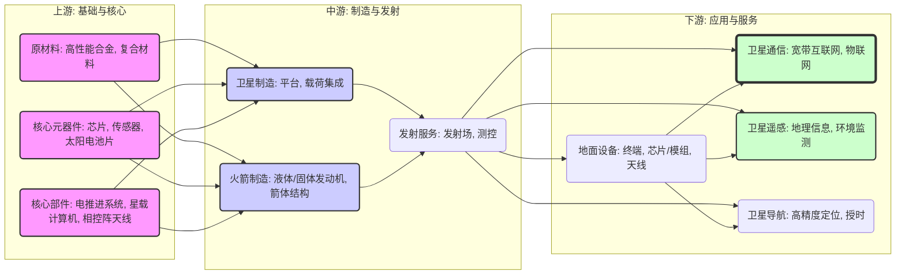

好的，收到您的指令。作为一位精通价值投资的分析师，我将严格遵循您提供的研究框架，对 **商业航天** 行业进行一次深入、结构化的全景扫描。

---

### **商业航天行业产业链全景扫描与投资价值分析报告**

**报告日期：** [当前日期]
**分析师：** 价值投资分析系统

#### **核心摘要**

商业航天正从“技术验证期”迈入“规模化应用期”，其核心驱动力已从政策主导转向技术与成本主导。产业链价值正从传统的卫星制造和火箭发射，向**下游的卫星应用服务（特别是卫星互联网）** 和**上游的核心元器件（如低成本芯片、电推进系统）** 转移。投资机会主要集中在能够实现大规模组网、降低单位成本并构建商业闭环的环节。

---

### **一、 产业链全景图**

商业航天产业链分为三个主要环节：上游（元器件与材料）、中游（卫星与火箭制造及发射服务）、下游（地面设备与应用服务）。

**价值分配（估算，基于典型低轨通信卫星星座）：**
*   **上游 (15-20%)：** 核心元器件（尤其是相控阵天线芯片、电推进系统）价值量高，技术壁垒高。
*   **中游 (25-30%)：** 卫星制造（平台+载荷）和火箭发射。发射成本目前占比最高，但随着可回收技术成熟，成本将大幅下降。
*   **下游 (50-60%)：** 这是未来最大的价值池。地面终端、网络运营、数据服务将占据产业链主要利润。

---

### **二、 市场规模分析**

| 市场层级 | 定义 | 2023年估算规模 (全球/中国) | 预测增速 (CAGR 2023-2028) | 渗透率/关键驱动因素 |
| :--- | :--- | :--- | :--- | :--- |
| **TAM (总可触达市场)** | 所有与航天相关的商业活动 | $450B / ¥1.2万亿 | 8-10% | 全球航天经济持续增长，新兴市场（如东南亚、非洲）需求旺盛。 |
| **SAM (可服务市场)** | 商业航天（非政府、非军用） | $200B / ¥5000亿 | 12-15% | 低轨卫星星座建设进入高峰期，卫星互联网、遥感商业化加速。 |
| **SOM (可获得市场)** | 中国民营商业航天企业可触及的市场 | ¥300-500亿 | 20-25% | 政策开放，技术突破，国产替代加速，但面临国家队竞争。 |

**关键洞察：**
*   **卫星互联网** 是未来5-10年最大的增量市场。全球未联网人口超过30亿，海事、航空、应急通信等都是刚需场景。
*   **卫星遥感** 市场正从政府订单向商业客户（农业、保险、金融）拓展，高分辨率、高频次、高光谱数据需求强劲。
*   **发射市场** 增速放缓，但“一箭多星”和“可回收复用”技术将推动发射成本下降，从而刺激下游应用市场爆发。

---

### **三、 竞争格局分析**

| 产业链环节 | 主要玩家 (中国) | 市场格局 | 竞争态势 |
| :--- | :--- | :--- | :--- |
| **上游：核心芯片** | 中国电科54所、国科天成、成都振芯科技 | 高度集中，国家队主导 | **高壁垒**，国产替代是主要逻辑。相控阵波束赋形芯片、抗辐射芯片是关键。 |
| **上游：电推进系统** | 航天科技510所、星际荣耀、星河动力 | 寡头格局，国家队与民营并存 | 技术路线正在从霍尔推进向更高效的射频离子推进演进。成本是核心。 |
| **中游：火箭制造/发射** | **国家队:** 航天科技(CZ系列)、航天科工(KZ系列) **民营:** 星际荣耀、星河动力、蓝箭航天、天兵科技 | 国家队绝对主导，民营加速追赶 | 竞争激烈，聚焦于**可回收复用**技术。蓝箭的液氧甲烷、天兵的液氧煤油路线各有千秋。 |
| **中游：卫星制造** | **国家队:** 航天五院、中科院微小卫星创新研究院 **民营:** 微纳星空、银河航天、长光卫星 | 国家队主导，民营在微小卫星领域崛起 | 竞争转向**批量化、流水线生产**能力。银河航天、微纳星空已实现百公斤级卫星的批产。 |
| **下游：卫星通信运营** | **国家队:** 中国卫通 **民营:** 银河航天、时空道宇 | 垄断格局，中国卫通拥有稀缺的轨道和频率资源 | 商业模式尚未完全跑通。**星地融合网络**是趋势，与地面5G/6G互补。 |
| **下游：卫星遥感应用** | **国家队:** 中国资源卫星应用中心 **民营:** 长光卫星、航天宏图、欧比特 | 分散竞争，民营企业在细分领域（AI解译）有优势 | 竞争核心是**数据获取能力**（星座规模）和**数据处理能力**（AI算法）。 |

---

### **四、 技术趋势分析**

1.  **火箭技术：可回收复用是唯一出路。**
    *   **路线之争：** 液氧甲烷（蓝箭、SpaceX的Raptor） vs 液氧煤油（天兵、SpaceX的Merlin）。甲烷更易维护、不易结焦，是未来深空任务的首选。煤油技术成熟、推力大，是当前主力。
    *   **变革方向：** 火箭结构一体化、3D打印发动机、不锈钢箭体（降低材料成本）。

2.  **卫星技术：从“功能定制”到“软件定义”。**
    *   **变革方向：** 软件定义卫星（通过软件更新改变功能）、平板式卫星（便于堆叠发射）、相控阵天线（实现灵活的波束赋形和跳频）。
    *   **核心专利：** 集中在低轨卫星星座组网技术、星间激光链路、抗干扰通信协议。

3.  **应用技术：AI+遥感、天地一体通信。**
    *   **变革方向：** AI解译遥感影像（从“看图”到“识图”）、卫星互联网与地面5G/6G融合、通导遥一体化（一张网提供通信、导航、遥感服务）。

---

### **五、 政策环境分析**

*   **监管框架：** 中国已发布《国家民用空间基础设施中长期发展规划》，鼓励社会资本进入。但发射审批、频率/轨道资源获取、数据安全仍是核心监管壁垒。
*   **补贴政策：** 地方政府（如北京、上海、广东、浙江）纷纷出台商业航天产业扶持政策，包括发射补贴、租金减免、人才引进等。国家层面，通过“新基建”将卫星互联网纳入，提供了长期资金支持。
*   **准入壁垒：**
    *   **高：** 火箭发动机技术、卫星平台设计、频率/轨道资源（“先登先占”）。
    *   **中：** 发射场使用权、高等级保密资质、批量化生产能力。
    *   **低：** 地面终端制造、软件应用开发。

---

### **六、 投资机会分析**

#### **最有价值的环节（首选）**
1.  **下游：卫星互联网应用与运营**
    *   **逻辑：** 这是产业链的“皇冠上的明珠”。一旦星座建成，运营服务将产生持续的、高毛利的现金流。谁能拿到运营牌照、建立用户生态，谁就能成为下一个“中国移动”。
    *   **关注点：** 拥有低轨卫星运营牌照的公司（如中国卫通）、与运营商深度绑定并已推出商业服务的公司（如银河航天）。

2.  **上游：核心元器件（相控阵天线芯片、抗辐射芯片）**
    *   **逻辑：** 卫星终端（尤其是相控阵天线）是卫星互联网普及的关键。其核心芯片技术壁垒极高，国产替代空间巨大。这是典型的“卖铲子”逻辑，无论下游哪家公司胜出，都离不开它们。
    *   **关注点：** 具备相控阵芯片设计能力和量产能力的公司。

#### **最被低估的环节（潜力股）**
1.  **中游：具备可回收能力的火箭制造公司**
    *   **逻辑：** 市场目前对民营火箭公司的估值主要基于其发射成功率和订单数，而忽略了**可回收技术一旦突破带来的成本指数级下降**。一旦成功，其估值将重构。目前市场对此认知不足，且技术路线尚不明朗，存在“黑马”机会。
    *   **关注点：** 技术路线清晰（液氧甲烷/煤油）、测试数据扎实、有明确可回收试验计划的公司（如蓝箭航天、天兵科技）。

2.  **下游：卫星遥感AI数据服务商**
    *   **逻辑：** 市场关注的是遥感卫星的数量和分辨率，但忽略了**将海量数据转化为客户可用的洞察（Insight）** 这一环节的价值。能提供高精度、自动化的AI解译服务的公司，将获得极高的客户粘性和定价权。
    *   **关注点：** 拥有强大的AI算法团队、与行业龙头（如农业、保险、金融）有深度合作的公司（如航天宏图）。

---

### **七、 产业链各环节评分表**

| 环节 | 市场规模 (5分) | 竞争格局 (5分) | 技术壁垒 (5分) | 政策壁垒 (5分) | 利润率 (5分) | 成长性 (5分) | **综合评分** |
| :--- | :--- | :--- | :--- | :--- | :--- | :--- | :--- |
| **上游：核心芯片** | 3 | 4 (寡头) | 5 | 4 | 5 | 4 | **4.2** |
| **上游：电推进** | 3 | 3 (集中) | 4 | 3 | 4 | 4 | **3.5** |
| **中游：火箭发射** | 4 | 2 (竞争激烈) | 5 | 4 | 2 (初期) | 4 | **3.5** |
| **中游：卫星制造** | 4 | 3 (竞争加剧) | 4 | 3 | 3 | 4 | **3.5** |
| **下游：通信运营** | 5 | 1 (垄断) | 3 | 5 | 5 | 5 | **4.0** |
| **下游：遥感应用** | 4 | 3 (分散) | 3 | 2 | 4 | 5 | **3.5** |

**评分说明：** 5分为最优。综合评分越高，代表该环节在当前时点的投资价值越高。

---

### **八、 值得深挖的公司清单**

**请注意：** 以下清单基于公开信息进行逻辑推演，不构成任何投资建议。投资前需进行独立的尽职调查。

1.  **银河航天 (民营)**
    *   **深挖理由：** 中国商业航天卫星制造的领军者，已完成多颗低轨宽带通信卫星在轨验证。其“柔性生产线”模式具有批量化生产的潜力。深度绑定中国卫通，在卫星互联网运营端有先发优势。**需关注其持续融资能力和盈利能力。**

2.  **蓝箭航天 (民营)**
    *   **深挖理由：** 全球第三家、中国首家实现液氧甲烷火箭入轨的民营公司。其“朱雀二号”技术路线被认为是未来可回收复用的最优解之一。如果可回收试验成功，将颠覆现有发射成本结构。**需关注其后续试验的成功率和商业化订单。**

3.  **航天宏图 (上市，688066)**
    *   **深挖理由：** 国内领先的遥感和地理信息服务商。拥有自主的PIE系列遥感软件平台，AI解译能力突出。其“天权”大模型在行业内领先。客户从政府向商业领域拓展，成长性高。**需关注其应收账款回款速度和商业客户拓展进度。**

4.  **国科天成 (上市，代码待查)**
    *   **深挖理由：** 专注于红外热成像和卫星通信核心芯片。其产品在相控阵天线、星载计算机等领域有广泛应用。受益于国产替代和卫星互联网建设双重逻辑，技术壁垒高，客户粘性强。**需关注其产品在星载领域的认证进展和产能扩张情况。**

**风险提示：**
*   **技术风险：** 可回收火箭、星间激光链路等关键技术突破不及预期。
*   **政策风险：** 频率/轨道资源分配、数据安全监管政策变化。
*   **商业风险：** 卫星互联网用户增长不及预期，商业模式无法闭环。
*   **竞争风险：** SpaceX等国际巨头以及国内国家队的竞争压力。

---
**报告结束**