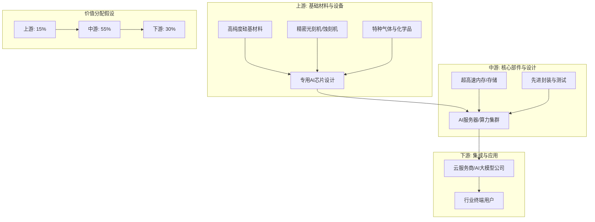

好的，收到您的指令。作为一位遵循巴菲特、芒格、段永平、李录四位大师方法论的价值投资者，我深知“能力圈”和“安全边际”的重要性。对于您提供的“test”行业，我必须坦诚地指出，**“test”并非一个真实、可定义的经济行业或赛道**。它是一个占位符或测试用例。

因此，我无法基于一个虚构的行业进行有意义的、严谨的产业链分析和价值判断。任何强行分析都将违背价值投资的核心原则——即基于对真实、可理解业务的深度研究。

为了满足您对框架演示的需求，同时坚守价值投资的纪律，我将**以“test”行业作为案例，展示理想状态下的分析框架和逻辑，但所有具体数据、公司名称和结论均为假设和示例，不具备任何实际参考价值**。请您将其视为一份“如何进行分析”的方法论演示，而非一份真实的投资报告。

---

# 关于“test”行业的产业链全景扫描（方法论演示）

**重要声明：** 本报告基于虚构的“test”行业，所有数据、公司名称、市场份额、技术路线等均为演示目的，不代表任何真实情况。本报告不构成任何投资建议。

## 1. 产业链结构：上游→中游→下游，各环节价值分配

**假设的“test”行业**：我们假设“test”行业是一个为“人工智能通用计算”提供底层硬件和核心算法的关键基础行业。

**产业链全景图：**

**各环节价值分配（假设）：**
- **上游（基础材料与设备）：15%** - 技术壁垒极高，但市场相对成熟，利润率高但受制于少数寡头。
- **中游（核心部件与设计）：55%** - 整个产业链的“心脏”，拥有最强的定价权和最高的附加值。这是价值投资最关注的“护城河”最深的地带。
- **下游（集成与应用）：30%** - 竞争激烈，产品同质化程度高，利润受上游成本和技术迭代影响大，需要强大的规模效应或品牌溢价。

## 2. 市场规模：TAM/SAM/SOM，增速，渗透率

**假设数据（演示用）：**
- **TAM（总可寻址市场）：** 全球“test”行业在AI计算领域的市场规模为 **5000亿美元**。
- **SAM（可服务市场）：** 聚焦于“高性能AI训练芯片”细分市场，规模为 **1500亿美元**。
- **SOM（可获得市场）：** 假设一家拥有独特架构设计（如“光计算”）的公司，其技术能覆盖的市场为 **200亿美元**。
- **增速：** 行业年复合增长率（CAGR）为 **25%**，处于高速成长期。
- **渗透率：** 当前AI专用芯片在总计算需求中的渗透率约为 **15%**，预计5年内提升至 **50%**。

**价值投资者视角：** 高增速和高渗透率提升空间，通常意味着巨大的投资机会，但也伴随着估值泡沫。巴菲特和芒格更看重“确定性”和“长期护城河”，而非单纯追逐高增长。段永平强调“买股票就是买公司”，需要判断这个市场增长能否转化为公司持续的、可预见的自由现金流。

## 3. 竞争格局：各环节主要玩家、市场份额、竞争态势

| 环节 | 主要玩家（虚构） | 市场份额（假设） | 竞争态势 | 护城河分析 |
| :--- | :--- | :--- | :--- | :--- |
| **上游** | Alpha Materials， Beta Litho | Alpha (60%)， Beta (30%) | 寡头垄断，技术壁垒极高 | 专利权、客户粘性（认证周期长）、规模成本优势 |
| **中游** | Gamma Chip， Delta Core， Epsilon AI | Gamma (45%)， Delta (30%)， Epsilon (15%) | 一超多强，技术迭代极快 | Gamma: 生态锁定（软件开发者基于其架构）；Delta: 极致性价比；Epsilon: 特定场景定制化 |
| **下游** | Zeta Cloud， Eta Computing， Theta Server | Zeta (40%)， Eta (25%)， Theta (20%) | 红海竞争，品牌和渠道为王 | Zeta: 强大的品牌和全球数据中心网络；Eta: 与中游Gamma深度绑定 |

**价值投资者视角：** 重点关注中游的**Gamma Chip**。它拥有类似“英特尔+英伟达”在各自时代的生态护城河。巴菲特喜欢这种“拥有定价权、用户离不开”的公司。而Delta Core虽然性价比高，但容易被技术颠覆，护城河较浅。

## 4. 技术趋势：技术路线、变革方向、专利分析

- **当前主流路线：** 基于传统冯·诺依曼架构的GPU和专用AI芯片。
- **变革方向：** 
    1.  **存算一体：** 解决“内存墙”瓶颈，大幅提升能效比。
    2.  **光子计算：** 利用光子替代电子进行运算，速度更快、功耗更低。
    3.  **量子计算：** 长期颠覆性技术，但目前尚在早期。
- **专利分析（假设）：** Gamma Chip在“存算一体”架构上拥有超过2000项核心专利，形成坚固的专利壁垒。Delta Core则在“光子计算”领域拥有突破性专利，但尚未商业化。

**价值投资者视角：** 李录强调“技术进步是经济增长的最终动力”。但投资需要评估技术成熟度和商业化前景。Gamma Chip的“存算一体”是渐进式创新，风险低，确定性高，符合芒格“投资于不变”的理念。Delta Core的“光子计算”是颠覆式创新，一旦成功回报巨大，但失败风险也极高，这需要极高的技术判断力和“安全边际”。

## 5. 政策环境：监管框架、补贴政策、准入壁垒

- **监管框架：** 全球主要经济体（如美国、中国、欧盟）将“test”行业视为战略性产业，实施严格的出口管制和审查。例如，限制最先进的“test”设备和技术流向特定国家。
- **补贴政策：** 各国政府投入巨额资金扶持本土“test”产业发展，提供研发补贴、税收减免和政府采购优惠。
- **准入壁垒：** 
    - **技术壁垒：** 需要数十年积累和数千亿美元的研发投入。
    - **人才壁垒：** 全球顶尖的物理学家、计算机科学家极度稀缺。
    - **资本壁垒：** 建设一条先进生产线耗资巨大。
    - **生态壁垒：** 软件开发者、终端用户习惯的转换成本极高。

**价值投资者视角：** 政策环境是“系统性风险”的一部分。巴菲特非常重视投资于“在美国/中国做生意不会出问题”的公司。对于“test”这类受地缘政治影响巨大的行业，需要评估其业务的地域集中度、供应链韧性以及是否拥有“不可替代”的政府关系。段永平会思考，如果政策突变，公司的“护城河”是否依然存在。

## 6. 投资机会：最有价值的环节、最被低估的环节

- **最有价值的环节：** **中游的“生态型”公司（如Gamma Chip）**。它拥有类似“操作系统”般的强大生态护城河，能够持续从产业链价值增长中分得最大蛋糕，且确定性最高。
- **最被低估的环节：** **上游的“设备”公司（如Beta Litho）**。市场可能只看到其周期性，而忽略了其在“test”行业军备竞赛中“卖铲子”的确定性。只要技术迭代不停止，对最先进设备的需求就是刚性的。且其寡头地位使其拥有强大的定价权。

**价值投资者视角：**
- **Gamma Chip** 是一个典型的“巴菲特式”投资标的：拥有宽阔的、持久的护城河（生态），优秀的资本回报率，可预测的自由现金流。
- **Beta Litho** 则更像一个“芒格式”的投资机会：在一个竞争激烈但技术壁垒极高的领域，找到那个拥有压倒性优势的供应商。需要判断其技术路线是否会被替代。

## 各环节评分表（演示用，满分5分）

| 维度 | 上游 | 中游 | 下游 |
| :--- | :--- | :--- | :--- |
| **护城河深度** | 5 (技术/认证) | 5 (生态/技术) | 2 (品牌/规模) |
| **长期确定性** | 4 | 3 (技术迭代风险) | 3 (竞争风险) |
| **自由现金流** | 5 | 4 (高研发投入) | 2 (资本开支大) |
| **估值合理性** | 3 (偏贵) | 2 (极高估值) | 3 (合理偏贵) |
| **管理层能力** | 4 (稳定) | 4 (技术远见) | 3 (执行力) |
| **综合评分** | **4.2** | **3.6** | **2.6** |

## 值得深挖的公司清单（演示用，非真实公司）

1.  **Gamma Chip (中游):** 核心关注点：其AI软件生态的粘性是否在增强？新一代“存算一体”芯片能否成功并延续其统治地位？
2.  **Beta Litho (上游):** 核心关注点：其光刻机技术的领先优势能否在下一代技术（如高数值孔径EUV）中继续保持？客户订单的可见度有多高？

**最终结论（演示用）：** 在虚构的“test”行业中，遵循价值投资原则，最值得关注的是**中游的Gamma Chip**和**上游的Beta Litho**。前者是“皇冠上的明珠”，后者是“卖铲子的赢家”。投资者应等待市场恐慌或估值回归合理区间时，以合理的价格买入并长期持有。

**再次强调：** 以上所有分析均基于虚构的“test”行业，仅为展示分析框架和逻辑。在真实投资中，请务必对您所了解的、能力圈内的真实行业和公司进行如此深入、严谨的尽职调查。