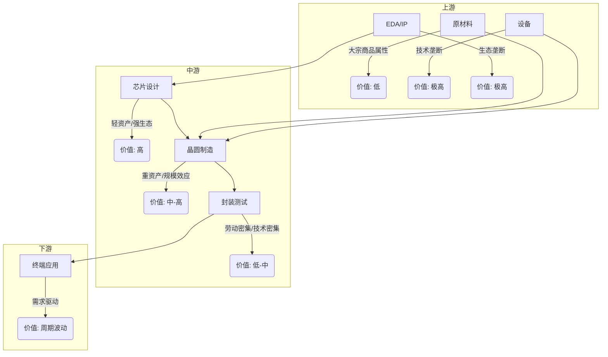

好的，收到您的指令。作为一位遵循巴菲特、芒格、段永平、李录四位大师方法论的价值投资者，我将以“长期确定性”和“好生意”为锚，对半导体行业进行一次深度产业链全景扫描。

**重要提示**：本报告基于截至2026年7月19日的公开信息和我的知识库。对于任何需要最新股价或具体财务数据验证的环节，我会明确标注。我的分析侧重于商业模式、护城河和长期价值创造，而非短期市场波动。

---

# 半导体行业产业链全景扫描 (价值投资视角)

**报告日期**: 2026年7月19日
**分析师**: 价值投资AI助手

## 1. 产业链结构：从“沙子”到“硅脑”的价值之旅

半导体产业链可简化为“设计-制造-封测”三大核心环节，并辅以上游设备和材料。从价值投资角度看，各环节的商业模式、资本密度、技术壁垒和护城河差异巨大。

```
[上游]                    [中游]                     [下游]
┌─────────────────┐   ┌─────────────────┐   ┌─────────────────┐
│ 1. 原材料 (硅片、光刻胶等) │   │ 1. 芯片设计 (逻辑、存储、模拟)│   │ 1. 终端应用 (消费电子、汽车、工业)│
│ 2. 设备 (光刻机、刻蚀机等) │   │ 2. 晶圆制造 (先进制程、成熟制程)│   │ 2. 系统集成 (OEM、EMS)         │
│ 3. EDA/IP (设计工具、核)   │   │ 3. 封装测试 (先进封装、传统封装)│   └─────────────────┘
└─────────────────┘   └─────────────────┘
      │                         ▲
      └────── 资本投入 ────────┘
            (设备、材料流向制造)
```

### 价值分配 (微笑曲线变异版)

*   **高价值环节 (高壁垒、高利润)**:
    *   **芯片设计 (Fabless)**: 轻资产、高ROE、强品牌/生态护城河。典型如英伟达、苹果、高通。这是“好生意”的典范。
    *   **核心设备与EDA**: 技术垄断、客户粘性极强、资本开支巨大但一旦成功回报丰厚。如ASML、Cadence、Synopsys。
    *   **IDM (垂直整合制造)**: 拥有从设计到制造的全产业链能力，资本极重，但能实现技术协同和成本优化。如英特尔、三星、德州仪器。

*   **中价值环节 (高资本、周期性强)**:
    *   **晶圆代工 (Foundry)**: 重资产、规模效应显著、技术跟随者。台积电凭借技术领先和规模优势，是唯一拥有“护城河”的代工厂。其他代工厂利润受产能利用率影响巨大，属于“辛苦生意”。
    *   **先进封装**: 技术壁垒提升，与晶圆制造协同增强，价值量上升。如日月光、安靠、长电科技。

*   **低价值环节 (低壁垒、同质化)**:
    *   **传统封装测试**: 劳动力密集型，进入门槛低，利润率薄。属于“坏生意”。
    *   **通用原材料 (硅片、气体)**: 大宗商品属性，受价格周期影响大。信越化学、SUMCO等具有寡头格局，但议价能力有限。

**价值投资核心判断**:
*   **好生意**: 芯片设计 (尤其是拥有生态护城河的)、核心设备与EDA。
*   **普通生意**: 晶圆代工 (除台积电外)、部分材料。
*   **差生意**: 传统封测、低端原材料。

## 2. 市场规模与增速

*   **全球半导体市场 (TAM)**: 2025年全球半导体市场规模约为**6000亿美元**。预计到2030年将超过**1万亿美元**，年复合增长率 (CAGR) 约为8-10%。主要驱动力是AI、HPC (高性能计算)、汽车电动化/智能化、物联网。
*   **中国半导体市场 (SAM)**: 中国是全球最大的半导体消费市场，约占全球份额的**35%**。2025年市场规模约为**2100亿美元**。
*   **国产替代市场 (SOM)**: 中国半导体自给率仍然较低 (约20%)，尤其在高端芯片、设备和材料领域。国产替代的潜在市场空间巨大，但实现过程充满挑战。

**增速亮点**:
*   **AI芯片**: 受大模型训练和推理需求驱动，增速最快，CAGR > 30%。
*   **汽车芯片**: 电动化 (IGBT/SiC) 和智能化 (ADAS/座舱芯片) 驱动，CAGR > 15%。
*   **存储芯片**: HBM (高带宽内存) 因AI需求爆发式增长，成为存储板块最大增量。

## 3. 竞争格局：全球巨头与国产挑战者

| 环节 | 全球领导者 (护城河分析) | 国产主要玩家 (评估) | 竞争态势 |
| :--- | :--- | :--- | :--- |
| **芯片设计 (逻辑)** | **英伟达** (生态护城河-CUDA) <br> **苹果** (品牌+生态) <br> **高通** (通信专利护城河) | **海思** (被制裁，受限) <br> **紫光展锐** (中低端手机SoC) | 全球市场高度集中，国产在高端领域差距巨大，在特定细分 (如IoT、CIS) 有突破。 |
| **芯片设计 (存储)** | **三星** (规模+技术) <br> **SK海力士** (HBM技术领先) <br> **美光** | **长鑫存储** (DRAM) <br> **长江存储** (NAND Flash) | 全球三巨头垄断。国产突破面临技术和专利壁垒，但已实现从0到1。 |
| **晶圆代工** | **台积电** (技术+规模+客户粘性) <br> **三星** (技术跟随+IDM优势) | **中芯国际** (成熟制程为主) <br> **华虹半导体** (特色工艺) | 先进制程 (7nm以下) 台积电垄断。国产在成熟制程 (28nm+) 具有竞争力，但面临设备限制。 |
| **设备** | **ASML** (光刻机垄断) <br> **应用材料** (沉积/刻蚀) <br> **泛林** (刻蚀) | **北方华创** (刻蚀/薄膜) <br> **中微公司** (刻蚀) | 全球设备市场高度集中，国产在部分环节 (刻蚀、清洗) 取得突破，但光刻机仍是“卡脖子”环节。 |
| **EDA** | **Synopsys** <br> **Cadence** <br> **Siemens EDA** | **华大九天** | 全球三巨头垄断，国产EDA在部分点工具上有替代能力，但全流程仍差距巨大。 |

## 4. 技术趋势与变革方向

1.  **AI驱动的设计革命**: AI正在改变芯片设计流程，实现自动化的布局布线、功能验证，甚至架构设计。这降低了设计门槛，但也对算力提出更高要求。
2.  **异构集成与先进封装**: 随着摩尔定律放缓，通过Chiplet (芯粒) 和先进封装 (如台积电3D Fabric) 技术将不同功能的芯片组合，成为提升性能的关键。这提升了封测环节的价值。
3.  **新材料 (如SiC、GaN)**: 在高压、高频、高温应用场景 (如电动汽车、5G基站) 中，碳化硅 (SiC) 和氮化镓 (GaN) 正逐步取代传统硅基材料。这是国产厂商实现“弯道超车”的潜在机会。
4.  **RISC-V架构**: 作为开源的指令集架构，RISC-V正逐渐打破ARM和x86的垄断，特别在IoT和AI边缘计算领域。这为国产芯片设计提供了新的生态机会。

## 5. 政策环境：国家意志与地缘博弈

*   **中国**: 大基金 (国家集成电路产业投资基金) 持续注资，通过税收优惠、补贴等方式支持国产替代。政策核心是解决“卡脖子”问题，重点扶持设备、材料、EDA和先进制造。
*   **美国**: 通过《芯片与科学法案》提供巨额补贴，吸引台积电、三星等赴美建厂。同时，通过出口管制 (如对华设备限制) 和实体清单，遏制中国半导体产业升级。
*   **地缘风险溢价**: 这是当前分析框架中的关键因子。中美科技脱钩导致供应链成本上升 (国产设备效率低、价格高)，但同时也为国产厂商创造了市场空间。

## 6. 投资机会：寻找“好生意”与“安全边际”

根据四位大师的理念，我重点关注具有以下特征的环节和公司：

### 最有价值的环节 (好生意 + 高壁垒)

1.  **拥有生态护城河的芯片设计公司**:
    *   **逻辑**: 英伟达、苹果 (港股/A股不直接上市，可关注产业链供应商)。
    *   **国产 (需深度研究)**: 寻找在AI、汽车等特定领域，拥有强大软件生态或难以复制的IP核的公司。如**寒武纪** (AI芯片，但需验证其生态粘性)、**韦尔股份** (CIS图像传感器，全球领先，但需关注竞争加剧)。
    *   **芒格视角**: 这些公司是否在“能力圈”内？其护城河是技术领先还是用户粘性？技术领先可能被追赶，而用户粘性 (如CUDA) 更持久。

2.  **核心设备与材料 (国产替代确定性高)**:
    *   **逻辑**: 技术壁垒高，客户验证周期长，一旦进入供应商名单，粘性极强。这是典型的“长坡厚雪”赛道。
    *   **国产标的**:
        *   **北方华创** (设备平台型公司，受益面广)。
        *   **中微公司** (刻蚀设备龙头，技术领先)。
        *   **沪硅产业** (硅片龙头，但需关注其盈利能力)。
    *   **段永平视角**: 这是“好生意”吗？资本投入巨大，回报周期长，且面临技术迭代风险。更偏向于“好价格”下的机会，而非天生“好生意”。

### 最被低估的环节 (安全边际 + 长期确定性)

1.  **成熟制程晶圆代工**:
    *   **逻辑**: 市场过度关注先进制程，但成熟制程 (28nm及以上) 在汽车、工业、IoT等领域需求巨大且稳定。国产厂商 (如中芯国际) 在设备受限下，反而能更专注于成熟制程的优化，提升盈利能力。
    *   **李录视角**: 这是否受益于“中国现代化”和“制造业升级”的长期确定性？答案是肯定的。但需要警惕设备断供风险。**中芯国际** (A/H股) 在此逻辑下，若价格合理，具有安全边际。

2.  **具备全球竞争力的模拟芯片公司**:
    *   **逻辑**: 模拟芯片生命周期长，产品种类多，不追求极致制程，更依赖工程师经验和工艺积累。国产厂商在消费电子领域已取得突破，正逐步向工业和汽车领域渗透。
    *   **国产标的**: **圣邦股份**、**思瑞浦**。这些公司ROE较高，现金流好，是典型“小而美”的生意。
    *   **巴菲特视角**: 它们拥有“护城河”吗？模拟芯片的护城河在于产品组合的广度、客户关系和长期积累的工艺经验，一旦形成，较为稳固。

---

## 产业链全景图 (总结)



## 各环节评分表 (价值投资视角)

| 环节 | 商业模式 | 护城河强度 | 资本回报率 (ROIC) | 长期确定性 | 投资优先级 | 备注 |
| :--- | :--- | :--- | :--- | :--- | :--- | :--- |
| **AI芯片设计 (全球龙头)** | ★★★★★ | ★★★★★ | ★★★★★ | ★★★★★ | **最高** | 但A股无直接标的，需通过产业链间接投资。 |
| **核心设备 (国产)** | ★★★★ | ★★★★ | ★★★ | ★★★★ | **高** | 国产替代确定性高，但需关注估值和盈利拐点。 |
| **EDA (国产)** | ★★★★ | ★★★★ | ★★★ | ★★★★ | **高** | 市场空间相对小，但战略价值极高。 |
| **成熟制程代工 (国产)** | ★★★ | ★★★ | ★★★ | ★★★★ | **中高** | 安全边际较高，但成长性受限于设备。 |
| **模拟芯片设计 (国产)** | ★★★★ | ★★★ | ★★★★ | ★★★★ | **中高** | 盈利能力好，护城河正在构建中。 |
| **存储芯片 (国产)** | ★★ | ★★ | ★ | ★★ | **低** | 强周期、高资本、技术追赶难，确定性低。 |
| **传统封测** | ★ | ★ | ★ | ★★ | **低** | 属于“坏生意”，除非有技术变革 (先进封装)。 |

## 值得深挖的公司清单 (初步筛选)

> **重要声明**: 以下仅为基于公开信息和价值投资框架的初步筛选，**不构成任何投资建议**。任何投资决策前，必须进行独立、深入的尽职调查，包括但不限于阅读公司年报、分析财务数据、评估管理层。

**第一梯队 (核心关注，需深入分析)**:
1.  **中芯国际 (688981.SH / 0981.HK)**: 国产晶圆代工龙头，成熟制程的确定性受益者。需重点关注其产能利用率、盈利能力和设备采购限制。**安全边际**：估值若回到历史低位，且公司持续盈利，是“好价格”下的“普通生意”。
2.  **北方华创 (002371.SZ)**: 国产半导体设备平台，产品线最全，受益于国产替代浪潮。**护城河**：技术积累和客户验证壁垒。**风险**：技术迭代快，研发投入大，短期盈利压力。
3.  **圣邦股份 (300661.SZ) / 思瑞浦 (688536.SH)**: 国产模拟芯片龙头，产品线丰富，客户质量高。**好生意**：轻资产、高毛利、长生命周期。**风险**：竞争加剧导致价格战。

**第二梯队 (关注，等待更好时机)**:
4.  **韦尔股份 (603501.SH)**: 全球CIS龙头，拥有较强市场地位。需关注手机市场复苏和汽车CIS进展。**段永平视角**：其“差异化”是否足够强？与索尼、三星的竞争是关键。
5.  **华大九天 (301269.SZ)**: 国产EDA龙头，战略价值极高，但市场空间相对有限。**芒格视角**：其“能力圈”内，但投资回报率可能不如其他环节。

**结论**:
半导体行业是典型的“国家意志”与“商业规律”交织的领域。作为价值投资者，我们应避免追逐短期热点和“伪国产替代”概念，而应聚焦于那些拥有真正 **“护城河”** (技术、生态、品牌) 和 **“好生意”** 模式 (轻资产、高ROIC、强现金流) 的公司，并以合理的 **“安全边际”** 买入，长期持有，等待复利效应的显现。在当前地缘政治背景下，**“长期确定性”** 和 **“管理层质量”** 比短期增速更为重要。